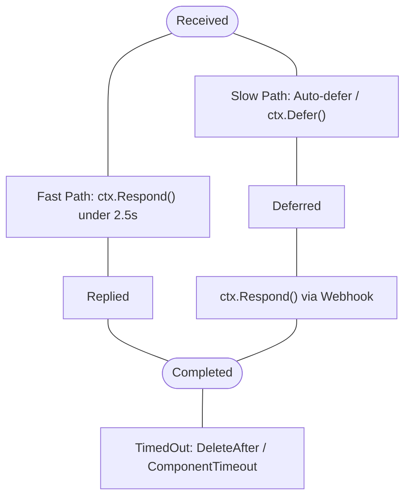

[Docs Overview](../README.md#documentation) / Context

# Context

Every command, component or modal handler receives a `*gdk.Context`. It handles option extraction, response lifecycles, target resolution and the 5 Entity Modules for responses, members, channels, roles and messages.

## Interaction Metadata

Extract caller and location information directly from the context:

```go
userID := ctx.Author.ID
username := ctx.Author.Username
guildID := ctx.GuildID
channelID := ctx.ChannelID
```

## Target Resolution

When executing context menu commands or slash commands with user/target options, `ctx` automatically resolves targets:

```go
// automatically reads interaction TargetID or user options
targetID := ctx.TargetID()
targetUser := ctx.TargetUser()
targetMember := ctx.TargetMember()

// resolves avatar with auto animated gif/png and default CDN fallbacks
userAvatar := targetUser.AvatarURL()
guildAvatar := targetMember.AvatarURL()
forcedGlobal := targetMember.AvatarURL(true, 256)

// for Message context menus, resolves the right-clicked message object
msg := ctx.ResolvedMessage()
```

## Option Extraction

Extract option arguments type-safely via `ctx.Opt(name)`:

```go
// primitives
name := ctx.Opt("name").String("default_name")
count := ctx.Opt("count").Int(1)
ratio := ctx.Opt("ratio").Float64(0.5)
active := ctx.Opt("active").Bool(false)

// snowflakes & entities
user := ctx.Opt("user").User()
member := ctx.Opt("user").Member()
role := ctx.Opt("role").Role()
channel := ctx.Opt("channel").Channel()
attachment := ctx.Opt("file").Attachment()
targetID := ctx.Opt("target").Snowflake()

// Autocomplete focused option discovery
if opt := ctx.FocusedOption(); opt != nil {
	currentInput := opt.Value
	_ = currentInput
}
```

## Deferral and Timeouts

Discord requires an initial response or deferral within 3 seconds. For long operations, defer the interaction:

```go
handler := func(ctx *gdk.Context) error {
	if err := ctx.Defer(false); err != nil {
		return err
	}

	time.Sleep(4 * time.Second)

	_, err := ctx.Respond("Task completed successfully!")
	return err
}
```

When `gdk.WithAutoDefer(true, 2500*time.Millisecond)` is active, `gdk` automatically defers interactions before the 3-second deadline expires if your handler has not yet responded.

### Context Cancellation (`ctx.Cancel()`)

Each interaction receives a derived context tied to the application's root shutdown lifecycle and timeout configuration. Calling `ctx.Cancel()` aborts this context immediately, signaling any background worker goroutines or timers to exit early:

```go
func longRunningTask(ctx *gdk.Context) error {
	defer ctx.Cancel()

	select {
	case <-ctx.Context().Done():
		return ctx.Context().Err()
	case res := <-computeWorker():
		_, err := ctx.Respond(res)
		return err
	}
}
```

## Entity Module 1: Respond

`ctx.Respond` routes immediate replies, deferred responses, followups and direct messages. See [Respond Module](modules/respond.md) for full details.

```go
// plain text reply
ctx.Respond("pong")

// private ephemeral reply
ctx.Respond("only you see this", true)

// direct error reply
ctx.Respond(err)

// structured response
ctx.Respond(gdk.Options{
	Content:    "server report",
	Ephemeral:  true,
	Embeds:     []gdk.Embed{myEmbed},
	Components: []gdk.Component{btnRow},
})

// direct message with automatic receipt
noMention := false
ctx.Respond(gdk.Options{
	Scope:   "dm",
	Target:  targetUserID,
	Content: "your verification code is 123-456",
	Mention: &noMention,
})

// standalone channel message
ctx.ChannelSuite(channelID).Send("standalone message posted to channel")
ctx.Typing()
```

### Response Lifecycle & Timeouts



Responses can automatically delete themselves or grey out interactive components without writing manual background timers:

```go
// self-destructing response (deletes after 5 seconds)
ctx.Respond(gdk.Options{
	Content:     "invalid syntax, cleaning up",
	DeleteAfter: 5 * time.Second,
})

// auto-disable interactive components after 30 seconds
ctx.Respond(gdk.Options{
	Embed:            myEmbed,
	Components:       []gdk.Component{btnRow},
	ComponentTimeout: 30 * time.Second,
})
```

When both are used, deletion safely cancels the component timer to prevent editing a removed message.

### Component Updates
```go
// in-place edit of message hosting clicked button or select
ctx.UpdateMessage(gdk.Options{
	Content: "button clicked",
})

// immediately grey out all buttons and select menus on current message
ctx.DisableComponents()

// acknowledge click without changing message
ctx.DeferUpdate()
```

## Entity Module 2: Member

The `ctx.Member` engine handles moderation, profile attributes, roles and guild voice states with automatic role hierarchy verification (`CanModerate`). See [Member Module](modules/member.md) for full details:

```go
// positional shortcuts
ctx.Member(targetID, "kick", "spamming")
ctx.Member(targetID, "ban", "7d", "raiding")
ctx.Member(targetID, "timeout", 10*time.Minute, "cooling off")
ctx.Member(targetID, "unban", "appeal accepted")
ctx.Member(targetID, "nick", "CleanNick")
ctx.Member(targetID, verifiedRoleID)

// structured options
ctx.Member(gdk.Options{
	Target:   targetID,
	Type:     "ban",
	Duration: "7d",
	Reason:   "compromised account",
})

// fluent suite
suite := ctx.MemberSuite(targetID)
suite.Timeout(15*time.Minute, "cooling off")
member, err := suite.Get()
```

## Entity Module 3: Channel

Create, edit, delete, lock, unlock or inspect channels. See [Channel Module](modules/channel.md) for full details:

```go
// lock current channel
ctx.Channel("lock", "emergency lockdown")

// unlock channel
ctx.Channel("unlock", "reason")

// create channel
ctx.Channel("create", "channel-name", "reason")

// structured channel options
ctx.Channel(gdk.Options{
	Type:   "create",
	Name:   "channel-name",
	Topic:  "channel topic",
	Reason: "reason",
})

// fluent channel suite
suite := ctx.ChannelSuite(channelID)
ch, err := suite.Get()
_ = suite.SetName("channel-name", "reason")
_ = suite.SetSlowmode("15s")
```

## Entity Module 4: Role

Manage roles with automatic role hierarchy validation (`CanManageRole`) and context caching. See [Role Module](modules/role.md) for full details:

```go
// delete role with audit reason
_, err := ctx.Role("delete", roleID, "reason")

// create role
role, err := ctx.Role("create", "role-name")

// structured role creation
role, err := ctx.Role(gdk.Options{
	Type:        "create",
	Name:        "role-name",
	Color:       0x5865F2,
	Hoist:       &isTrue,
	Mentionable: &isTrue,
})

// fluent role suite
suite := ctx.RoleSuite(roleID)
_ = suite.Assign(memberUserID, "reason")
_ = suite.SetColor(0x3498DB)
```

## Entity Module 5: Message

Manage chat messages: pins, unpins, deletions, crossposting, reactions, older message edits and purges. See [Message Module](modules/message.md) for full details:

```go
// pin message
ctx.Message(messageID, "pin", "reason")

// delete message
ctx.Message(messageID, "delete", "reason")

// react with unicode or server custom emojis
ctx.Message(messageID, "react", "🦆", "<:custom_emoji:123456789>")

// remove bot reaction
ctx.Message(messageID, "unreact", "🦆")

// bulk purge messages from current channel
ctx.Message("purge", 50, "reason")

// edit older message by ID
ctx.Message(gdk.Options{
	Target:  messageID,
	Type:    "edit",
	Content: "updated message content",
})

// fluent message suite
suite := ctx.MessageSuite(messageID)
msg, err := suite.Get()
_ = suite.React("🦆")
_ = suite.SetContent("updated message content")
```

---

## Connected Topics

| Context | Destination | Description |
| :--- | :--- | :--- |
| **Previous** | [Commands](commands.md) | Slash commands, options, choices and routing |
| **Next** | [Entity Modules](modules/index.md) | Overview of the 5 unified execution engines |
| **Modules** | [Respond](modules/respond.md), [Member](modules/member.md), [Channel](modules/channel.md), [Role](modules/role.md), [Message](modules/message.md) | Deep dives into each entity engine |
| **Components** | [Components & Modals](components.md) | Buttons, select menus, action rows and modal dialogs |
| **Transports** | [Transports](transports.md) | Context cancellation, auto-deferral and timeout lifecycles |
| **API Reference** | [Context API](api-reference.md#context) | `*gdk.Context` methods, option getters and action suites |
