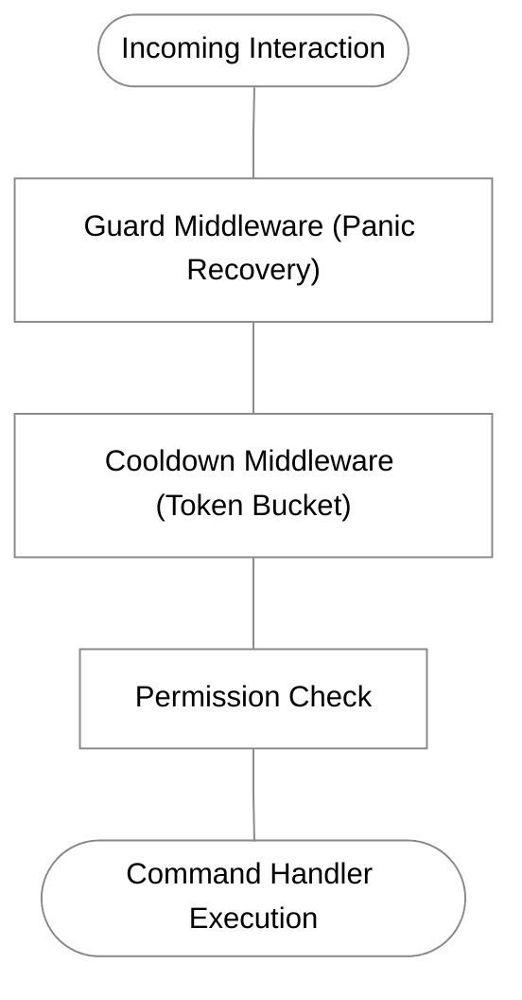

[Docs Overview](../README.md#documentation) / Middleware

# Middleware

`gdk` uses an extensible middleware pipeline to enforce token-bucket cooldowns, permission checks and panic recovery across interactions.

## Pipeline Scopes



Middleware can run globally across every interaction or selectively on individual commands:

```go
app.Use(gdk.Guard(
	gdk.WithMessage("internal error occurred"),
	gdk.WithEphemeral(true),
))
```

## Token-Bucket Cooldowns

Protect commands from spam using the token-bucket cooldown engine.

### Direct Command Cooldown
Enforce a cooldown by setting the `Cooldown` field on `gdk.Command`. You can also configure the target scope using `CooldownScope` which defaults to `gdk.CooldownScopeUser`:

```go
cmd := gdk.Command{
	Name:          "daily",
	Description:   "claim daily reward",
	Cooldown:      24 * time.Hour,
	CooldownScope: gdk.CooldownScopeUser,
	Execute: func(ctx *gdk.Context) error {
		return ctx.Respond("claimed")
	},
}

app.Command(cmd)
```

> [!IMPORTANT]
> `gdk.Command.Cooldown` is statically typed as `time.Duration`.
> - Always supply a typed `time.Duration` (e.g. `10 * time.Second`, `24 * time.Hour`).
> - Do not pass a string literal like `"10s"` (fails compilation: cannot use untyped string as `time.Duration`).
> - Do not pass an untyped integer like `10` (in Go, `10` evaluates to 10 nanoseconds, expiring instantaneously).
> - If you want to parse a human string dynamically in a struct literal, use `gdk.Time("10s").Duration()`.

Supported `CooldownScope` values on `gdk.Command`:
- `gdk.CooldownScopeUser`: Isolated per user ID (default).
- `gdk.CooldownScopeChannel`: Isolated per channel ID.
- `gdk.CooldownScopeGuild`: Shared across the entire guild.
- `gdk.CooldownScopeGlobal`: Shared across the entire bot process.

### Advanced Cooldown Policies
Use the middleware helper for fine-grained scopes:

```go
// 1 use per 30 seconds across the guild
mw := gdk.Cooldown(
	[]gdk.Policy{
		gdk.GuildCooldown(30 * time.Second),
	},
	gdk.WithCooldownAutoRespond(true),
	gdk.WithCooldownMessage("guild is on cooldown: try again in {time}"),
)
```

Available policy constructors:
- `gdk.UserCooldown(duration, burst...)`: Isolated per user ID.
- `gdk.ChannelCooldown(duration, burst...)`: Isolated per channel ID.
- `gdk.GuildCooldown(duration, burst...)`: Shared across all members in the guild.
- `gdk.GlobalCooldown(duration, burst...)`: Shared across the entire bot process.

Unlike struct literals, all policy constructors accept flexible input types for duration:
- `time.Duration`: `30 * time.Second`, `5 * time.Minute`
- Integer: `30` (automatically interpreted as 30 seconds)
- Human duration string: `"30s"`, `"5m"`, `"1h"`, `"1d"`
- Optional burst: `gdk.UserCooldown("5s", 2)` allows 2 requests every 5 seconds.

## Permissions Guard

Enforce required Discord permissions before command execution:

### Direct Command Permissions
Set the `Permissions` bitmask on `gdk.Command`:

```go
cmd := gdk.Command{
	Name:        "ban",
	Description: "ban a member",
	Permissions: gdk.PermissionBanMembers,
	Execute: func(ctx *gdk.Context) error {
		return ctx.Respond("banned")
	},
}

app.Command(cmd)
```

### Granular User and Bot Checks
```go
mw := gdk.RequirePermissions(
	gdk.PermissionKickMembers,
	gdk.PermissionAdministrator,
)
```

Administrators bypass permission checks automatically.

## Panic Recovery

The `Guard` middleware intercepts unhandled panics, safely responds with an ephemeral error to prevent process crashes and can route crash traces to `gdk.Logger` or a custom panic callback:

```go
// route to file logger (silencing terminal crash spam)
app.Use(gdk.Guard(gdk.WithGuardLogger(logger)))

// or attach custom telemetry hook
app.Use(gdk.Guard(
	gdk.WithPanicHandler(func(ctx *gdk.Context, recovered any, stack []byte) {
		telemetry.CapturePanic(recovered, stack)
	}),
))
```

## Custom Middleware

Custom middleware wraps the `gdk.Handler` function:

```go
func LoggingMiddleware() gdk.Middleware {
	return func(next gdk.Handler) gdk.Handler {
		return func(ctx *gdk.Context) error {
			start := time.Now()
			err := next(ctx)
			duration := time.Since(start)

			log.Printf("interaction handled in %s", duration)
			return err
		}
	}
}

app.Use(LoggingMiddleware())
```

---

## Connected Topics

| Context | Destination | Description |
| :--- | :--- | :--- |
| **Previous** | [Components & Modals](components.md) | Embed builders, buttons, select menus and modal dialogs |
| **Next** | [Synchronization](sync.md) | Differential command hashing and schema synchronization |
| **Commands** | [Commands](commands.md) | Slash commands, option validations and cooldown parameters |
| **Transports** | [Transports](transports.md) | Gateway WebSocket and HTTP Webhook execution models |
| **Utilities** | [File Logger](utilities.md#logging-utility-gdklogger) | Routing panic logs and interaction metrics cleanly |
| **API Reference** | [Middleware API](api-reference.md#middleware) | Guard options, cooldown engine and error sentinels |
