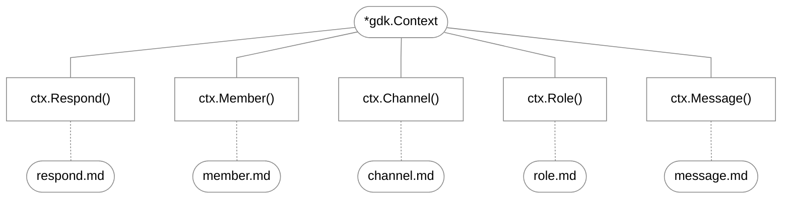

[Docs Overview](../../README.md#documentation) / [Context](../context.md) / Entity Modules

# Entity Modules

`gdk` organizes all Discord interactions under 5 Entity Modules available on `*gdk.Context`. Instead of navigating hundreds of fragmented driver endpoints, every interaction flow is routed through an entity-driven, type-safe API.

---

## The 5 Entity Modules



| Module | Method | Domain | Documentation |
| :--- | :--- | :--- | :--- |
| **Respond** | `ctx.Respond(...)` | User replies, DMs, standalone channel messages, followups | [respond.md](respond.md) |
| **Member** | `ctx.Member(...)` | Guild member moderation (kick/ban/timeout), profiles (nick/roles), voice state | [member.md](member.md) |
| **Message** | `ctx.Message(...)` | Message pinning, unpinning, deletion, crossposting, reactions | [message.md](message.md) |
| **Channel** | `ctx.Channel(...)` | Channel creation, edits, deletion, purges, lockdowns | [channel.md](channel.md) |
| **Role** | `ctx.Role(...)` | Role creation, edits, deletion, hierarchy checks | [role.md](role.md) |

---

## Universal Options Field Matrix

All entity methods accept `gdk.Options`. This matrix shows which fields are read by each module:

| Field | Type | `Respond` | `Member` | `Message` | `Channel` | `Role` |
| :--- | :--- | :---: | :---: | :---: | :---: | :---: |
| `Type` | `any` | yes ("send") | yes ("ban", "timeout", etc.) | yes ("pin", "react", "purge") | yes ("create", "lock", etc.) | yes ("create", "edit", "delete") |
| `Scope` | `any` | yes ("dm", "guild") | - | - | - | - |
| `Target` | `gdk.Snowflake` | yes (dm user) | yes (member user id) | yes (target message) | yes (target channel) | yes (target role) |
| `Channel` | `gdk.Snowflake` | yes (send target) | - | yes (channel id) | yes (channel id) | - |
| `Content` | `string` | yes | - | yes (edit) | - | - |
| `Reason` | `string` | - | yes | yes | yes | yes |
| `Emoji` | `any` | - | - | yes | - | - |
| `Ephemeral` | `bool` | yes | - | - | - | - |
| `Mention` | `*bool` | yes (@ off) | - | - | - | - |
| `Typing` | `bool` | yes | - | - | - | - |
| `Embed` | `any` | yes (single embed) | - | - | - | - |
| `Embeds` | `[]gdk.Embed` | yes | - | yes (edit) | - | - |
| `Components` | `[]gdk.Component` | yes | - | yes (edit) | - | - |
| `Files` | `[]types.File` | yes | - | yes (edit) | - | - |
| `TTS` | `bool` | yes | - | - | - | - |
| `Deferred` | `bool` | yes | - | - | - | - |
| `ComponentTimeout` | `any` | yes (auto-disable components) | - | - | - | - |
| `DeleteAfter` | `any` | yes (auto-delete message) | - | - | - | - |
| `Duration` | `any` | - | yes (timeout/purge) | - | - | - |
| `Count` | `int` | - | - | yes (purge) | yes (purge) | - |
| `Name` | `string` | - | - | - | yes | yes |
| `Topic` | `string` | - | - | - | yes | - |
| `Slowmode` | `any` | - | - | - | yes | - |
| `Color` | `int` | - | - | - | - | yes |
| `Permissions` | `*types.Permission` | - | - | - | - | yes |
| `Hoist` | `*bool` | - | - | - | - | yes |
| `Mentionable` | `*bool` | - | - | - | - | yes |
| `Role` | `gdk.Snowflake` | - | yes (single role) | - | - | yes (target role) |
| `AddRoles` | `[]gdk.Snowflake` | - | yes | - | - | - |
| `RemoveRoles` | `[]gdk.Snowflake` | - | yes | - | - | - |
| `Nickname` | `*string` | - | yes | - | - | - |
| `VoiceMute` | `*bool` | - | yes | - | - | - |
| `VoiceDeaf` | `*bool` | - | yes | - | - | - |
| `VoiceChannel` | `*types.Snowflake` | - | yes | - | - | - |

---

## Two Ways to Call

Every module supports two complementary styles:

1. **Positional syntax**: quick, everyday one-liners for standard commands.
2. **Options struct**: complete control over all Discord parameters in a single typed struct.

```go
// positional shortcut
ctx.Member(userID, "timeout", 10*time.Minute, "cooling off")

// options struct
ctx.Member(gdk.Options{
    Target:   userID,
    Type:     "timeout",
    Duration: 10 * time.Minute,
    Reason:   "cooling off",
})
```

---

## Connected Topics

| Context | Destination | Description |
| :--- | :--- | :--- |
| **Upstream** | [Context Engine](../context.md) | Handler context, option getters, response lifecycle and deferral |
| **Next Guide** | [Components & Modals](../components.md) | Interactive buttons, select menus, action rows and modal dialogs |
| **Respond** | [respond.md](respond.md) | Replies, direct messages, standalone messages and deferral |
| **Member** | [member.md](member.md) | Moderation (kick/ban/timeout), profiles, voice states and hierarchy checks |
| **Channel** | [channel.md](channel.md) | Channel creation, edits, deletions, lock/unlock and purges |
| **Role** | [role.md](role.md) | Role creation, edits, hierarchy checks, deletions and assignments |
| **Message** | [message.md](message.md) | Pins, unpins, deletions, crossposting, reactions and older message edits |
| **API Reference** | [Action Suites](../api-reference.md#fluent-action-suites) | Fluent companion suites and method signatures |
