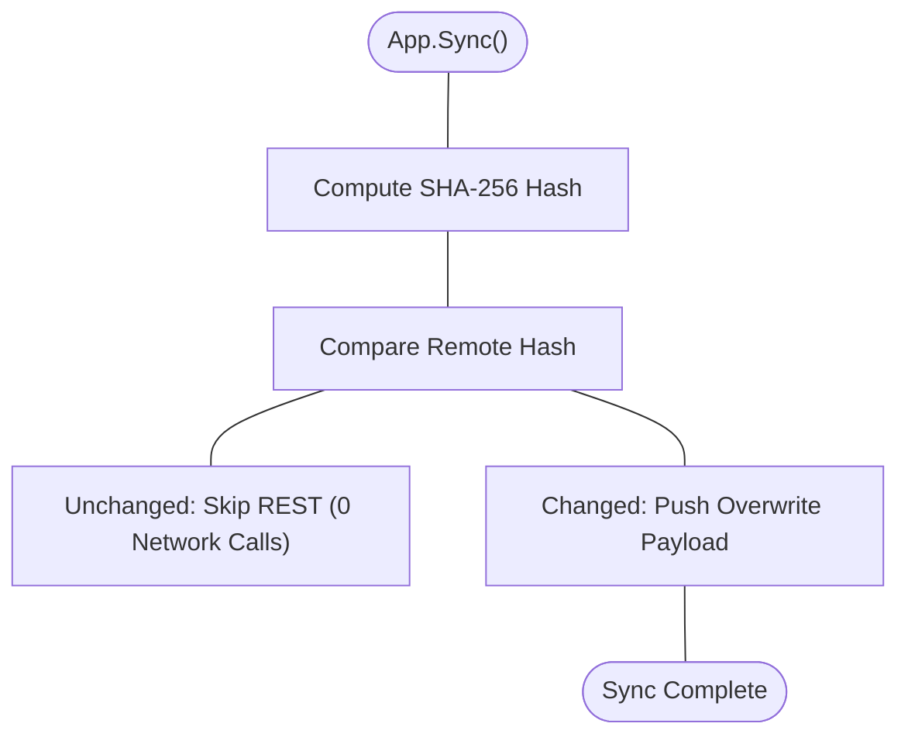

[Docs Overview](../README.md#documentation) / Command Synchronization

# Synchronization

Discord imposes strict rate limits on the application command overwrite endpoints. `gdk` features an intelligent differential synchronization engine that avoids redundant network requests on process restarts.

## How Differential Sync Works



When command synchronization executes:
1. `gdk` computes a deterministic SHA-256 hash across all registered command names, descriptions, options, choices and permissions.
2. It compares this hash against the remote state or the last acknowledged hash stored in memory.
3. If the hash matches, `gdk` skips the HTTP request entirely (`0` REST calls).
4. If definitions have changed, `gdk` pushes the updated payload and purges deleted commands from Discord.

## Dev Guild vs Global Sync

### Development Guild Mode
During active development, global command updates can take up to an hour to propagate across Discord's CDN edge nodes. Enabling `DevMode` synchronizes commands directly to your test server for immediate availability:

```go
app, err := gdk.NewApp(
	token,
	appID,
	gdk.WithDevMode(true, devGuildID),
	gdk.WithAutoSync(true),
)
```

### Production Global Mode
In production environments, omit `WithDevMode` or set it to `false`. Commands will register globally to all guilds where the bot is installed:

```go
app, err := gdk.NewApp(
	token,
	appID,
	gdk.WithDevMode(false),
	gdk.WithAutoSync(true),
)
```

## Explicit Synchronization

If `WithAutoSync(false)` is used, trigger synchronization manually during bot bootstrapping:

```go
// standard sync
if err := app.Sync(ctx); err != nil {
	log.Fatalf("sync failed: %v", err)
}

// sync with detailed differential metrics
result, err := app.SyncWithResult(ctx)
if err != nil {
	log.Fatalf("sync failed: %v", err)
}

fmt.Printf("synced commands: %d updated, %d skipped\n",
	result.Updated, result.Skipped)
```

## Non-Blocking Concurrency

The synchronization engine operates on an in-memory snapshot of registered commands and hashes, ensuring that outgoing Discord REST network calls never block incoming user commands, button clicks or modal submissions. Interaction routing remains fully responsive during background syncs.

---

## Connected Topics

| Context | Destination | Description |
| :--- | :--- | :--- |
| **Previous** | [Middleware](middleware.md) | Token-bucket rate limits, permissions and panic guards |
| **Next** | [Transports](transports.md) | Persistent Gateway WebSocket and serverless HTTP Webhook modes |
| **Commands** | [Commands](commands.md) | Slash command declarations, schema structures and validation rules |
| **Getting Started** | [Environments](getting-started.md#environments) | Configuring `WithDevMode` and instant guild command propagation |
| **API Reference** | [Sync Methods](api-reference.md#type-app-methods) | `Sync` and `SyncWithResult` method declarations |
