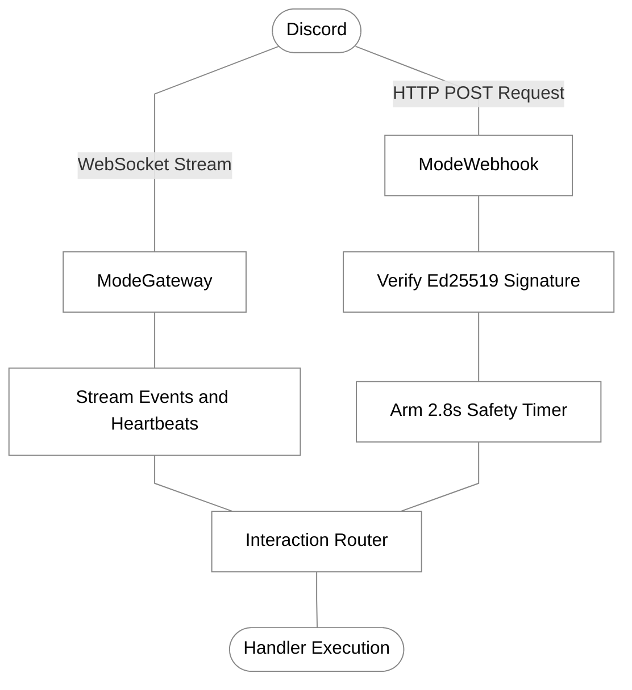

[Docs Overview](../README.md#documentation) / Transports

# Transports

`gdk` supports dual execution transports: persistent Gateway WebSocket connections or serverless HTTP Webhook listeners.

## Transport Comparison



| Feature | Gateway Mode (`ModeGateway`) | Webhook Mode (`ModeWebhook`) |
| :--- | :--- | :--- |
| **Connection** | Persistent WebSocket | Stateless HTTP POST |
| **Gateway Events** | Yes (`MESSAGE_CREATE`, `GUILD_CREATE`) | No (interactions only) |
| **Infrastructure** | Long-running container, VPS or VM | Serverless container (Cloud Run, AWS Lambda) |
| **Verification** | Token authentication | Ed25519 cryptographic request signature |
| **Entry Point** | `app.Run(ctx)` | `app.Run(ctx)` |

## Gateway WebSocket Mode

Gateway mode connects to Discord's WebSocket clusters and streams events continuously. This is the default mode:

```go
app, err := gdk.NewApp(
	token,
	appID,
	gdk.WithMode(gdk.ModeGateway),
	gdk.WithIntents(gdk.IntentsDefault),
)

// blocks while streaming events
if err := app.Run(ctx); err != nil && err != context.Canceled {
	log.Fatalf("gateway error: %v", err)
}
```

## Webhook HTTP Server Mode

Webhook mode requires no persistent outbound WebSocket connection. Discord delivers interaction payloads to an exposed HTTP endpoint via POST requests signed with your application's public key.

### Configuration
Configure the listen address, URL path and hex-encoded Ed25519 public key using `WithWebhook`:

```go
publicKey := os.Getenv("PUBLIC_KEY")

app, err := gdk.NewApp(
	token,
	appID,
	gdk.WithWebhook(":8080", "/interactions", publicKey),
)
```

### Running the Webhook Server
`app.Run(ctx)` starts the internal HTTP server with built-in Ed25519 cryptographic signature verification and handles graceful shutdown when the context cancels:

```go
if err := app.Run(ctx); err != nil && err != context.Canceled {
	log.Fatalf("server error: %v", err)
}

_ = app.Close()
```

## Auto-Defer and Safety Fallbacks

Discord enforces a strict 3-second acknowledgement window for all interactions:

### Auto-Defer
When enabled via `gdk.WithAutoDefer(true, 2500*time.Millisecond)` (default: enabled at 2.5s), `gdk` automatically checks interaction handlers. If the handler has not responded before the deadline:
- **Application Commands, Message Components and Modals** are automatically deferred so your handler can finish computing and respond via REST followups.
- **Ping and Autocomplete interactions** are never auto-deferred (since Discord does not support deferral on these interaction types).

### Webhook 2.8s Safety Fallback Timer
In Webhook mode, `gdk` arms an internal 2.8-second safety fallback timer for each incoming HTTP request:
- If a command or component handler has not responded, it sends an emergency deferred acknowledgment to prevent an `"Interaction failed"` error in Discord.
- If an autocomplete interaction has not responded, it sends an empty choices payload (`[]Choice{}`) so the Discord client UI doesn't spin indefinitely.
- If a Ping interaction has not responded, it immediately sends a Pong callback.

---

## Connected Topics

| Context | Destination | Description |
| :--- | :--- | :--- |
| **Previous** | [Synchronization](sync.md) | Differential command hashing and schema synchronization |
| **Next** | [Utilities](utilities.md) | Duration parsing, Discord timestamps and file logging |
| **Getting Started** | [Getting Started](getting-started.md) | Application bootstrapping and lifecycle options |
| **Context** | [Context Guide](context.md#deferral-and-timeouts) | Deferrals, cancellation and response deadlines |
| **API Reference** | [Configuration API](api-reference.md#functional-options) | `WithMode`, `WithWebhook`, `WithIntents` and `WithTimeout` |
