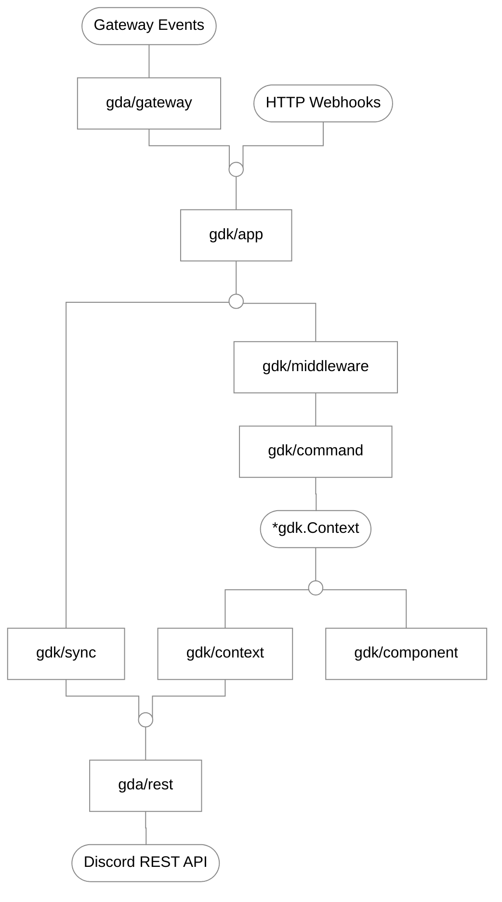

# Go Discord Kit

## Overview

`gdk` is an application command framework built on top of `gda`. It provides slash command routing, differential command synchronization, token-bucket rate limiting, UI component handling and dual execution transports (persistent Gateway WebSocket or serverless HTTP Webhooks) using only the Go standard library.

## Installation

Requires Go 1.24 or higher:

```bash
go get github.com/sfossl/gdk
```

## Architecture

`gdk` is organized into focused subsystems:

- **App**: Application lifecycle runner, functional configuration, graceful shutdown, dual execution transports and modular registration (`Module`).
- **Command**: Slash command declarations, typed option definitions across all 9 Discord option types, subcommand trees, autocomplete routing and local schema validation.
- **Context**: Execution context passed to handlers, typed option extraction with default fallbacks, automatic 2.5-second deferral and fluent action suites.
- **Component**: Declarative builders for rich embeds with strict limit checking, buttons, select menus, action rows with auto-packing (`PackRows`) and modals.
- **Middleware**: Interception pipelines, 64-shard partitioned token-bucket cooldown store, permission checks and panic recovery (`Guard`).
- **Utilities**: Compound human duration parsing (`1h 30m`, `2d`) and dynamic Discord markdown timestamp formatting (`<t:UNIX:STYLE>`).



## Capabilities

- **Differential Synchronization**: Deterministic SHA-256 hash comparison across registered command schemas on startup, issuing zero REST requests when definitions are unchanged.
- **Automatic Deferral**: Transparently defers interactions before Discord's 3-second deadline expires, seamlessly routing follow-up responses to asynchronous webhook edits.
- **Modern Interactions and Event Hooks**: Optimized for Discord's application command architecture while retaining direct access to raw Gateway events (`OnMessageCreate`) via `gda` for custom message parsing when needed.
- **Stateless Action Suites**: Fluent moderation, role and channel actions with built-in client-side role hierarchy verification prior to dispatching REST calls.
- **Dual Transports**: Run as a persistent Gateway WebSocket connection or deploy as a serverless HTTP Webhook handler with Ed25519 cryptographic signature verification.

## Ecosystem

`gdk` is the application layer of the SFOSSL Discord ecosystem:

- **[`gda`](https://github.com/sfossl/gda)**: Low-level driver for Gateway WebSocket events and REST API v10 endpoints.
- **`gdk`**: Higher-level interaction framework built on top of `gda`. Provides slash command routing, auto-deferrals, cooldowns and action suites.

## Properties

- **True Multi-Core Concurrency**: Executes every interaction on Go's M:N goroutine scheduler across all available CPU cores without blocking connection lifecycles or heartbeat workers.
- **Single Static Binary and Low Footprint**: Compiles to a self-contained, statically linked binary with zero external dependencies and an idle memory footprint under 20MB. Eliminates large runtime installations, container layer bloat and dependency drift between environments.
- **Deterministic Differential Sync**: Avoids exhausting Discord's daily application command creation limits (Error Code 30034) by hashing registered command schemas with SHA-256 on boot, issuing zero REST requests when schemas are unchanged.
- **Safe Typed Option Extraction**: Eliminates untyped pointer traversal and runtime nil-dereference panics through indexed, chainable option accessors with default values (`ctx.Opt("query").String()`).
- **Serverless and Dual Transports**: Native support for both persistent Gateway WebSockets and stateless HTTP Webhooks with Ed25519 signature verification, enabling seamless deployments on containerized serverless platforms.

## Limitations

`gdk` is intentionally specialized for modern interaction-based applications. It is not a general-purpose framework for every type of Discord bot:

- **No Voice or Audio Streaming**: `gdk` does not implement voice Gateway connections, Opus encoding or media streaming. If your bot's primary capability is voice playback or music streaming, dedicated audio libraries are currently a better fit.
- **No Monolithic In-Memory Entity Cache**: Unlike frameworks that store gigabytes of guild, member, role and presence objects in RAM by default, `gdk` runs stateless. Querying deep member or guild metadata requires explicit REST calls, which introduces network round-trip latency unless paired with a cache.
- **No Built-in Chat Prefix Router**: `gdk` is architected exclusively around Discord's modern Application Commands (slash commands, context menus, buttons, select menus and modals). While raw message events (`OnMessageCreate`) can be handled via the underlying driver, `gdk` provides no built-in prefix parser (e.g. `!command`), argument tokenizer or legacy command routing.
- **Ecosystem Maturity**: `gdk` is focused on core primitives rather than an extensive marketplace of third-party plugins, web dashboards or high-level database ORMs.

## Roadmap

- **Pluggable Caching Engine**: An embedded, zero-configuration key-value caching companion package designed to provide sub-microsecond in-memory state and eliminate REST round-trips for high-traffic bots.
- **Modular Voice Extensions**: Dedicated audio and voice Gateway extensions maintained as optional modules outside the core driver. Community contributions in this area are welcome.

## Documentation

| Guide | Description |
| :--- | :--- |
| **[Getting Started](.docs/getting-started.md)** | Bootstrap layout, app options, lifecycle and environment setup |
| **[Slash Commands](.docs/commands.md)** | Slash commands, option types, subcommands, choices and autocomplete |
| **[Execution Context](.docs/context.md)** | Handler context, option getters, response lifecycle and auto-deferral |
| **[Unified Modules](.docs/modules/index.md)** | Universal options matrix and the 5 unified execution engines |
| **[Components & Modals](.docs/components.md)** | Embed builders, buttons, select menus, action rows and modals |
| **[Middleware](.docs/middleware.md)** | Token-bucket cooldowns, permission guards and panic recovery |
| **[Command Synchronization](.docs/sync.md)** | Differential SHA-256 command hashing and zero-REST deployment |
| **[Transports](.docs/transports.md)** | Gateway WebSocket and serverless Ed25519 HTTP Webhook models |
| **[Time Utilities](.docs/utilities.md)** | Compound duration parsing, dynamic Discord timestamps and logger |
| **[API Reference](.docs/api-reference.md)** | Full specification of exported types, methods and error sentinels |

## References

- **[`gda`](https://github.com/sfossl/gda)**: Low-level Go driver for Gateway WebSocket connections and REST API v10 endpoints.
- **[Discord Developer Documentation](https://discord.com/developers/docs)**: Official reference for Discord API v10, interactions and application commands.
- **[RFC 8032](https://datatracker.ietf.org/doc/html/rfc8032)**: Edwards-Curve Digital Signature Algorithm (Ed25519) specification used for interaction webhook verification.
